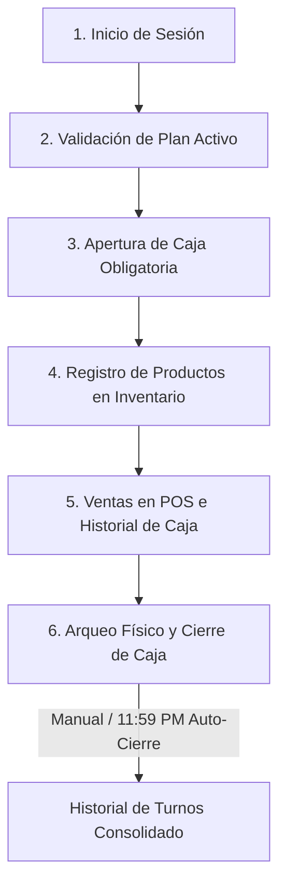

# GKAD STOCK — Sistema POS & Inventario Multi-Tenant (V5.0 Enterprise)

Sistema de Punto de Venta (POS), Gestión de Inventarios y Administración SaaS Multi-Tenant, diseñado con arquitectura desacoplada **MVC** para máxima escalabilidad, seguridad y resiliencia operativa.

---

## 📐 Arquitectura del Sistema

```
┌─────────────────────────────────────────────────────────┐
│                    FRONTEND (React)                      │
│  Zustand Stores ─── Components ─── Supabase Realtime    │
│         │                │                               │
│    useAuthStore     POSTerminal                          │
│    useShopStore     Inventory                            │
│                     SalesHistory                         │
│                     Dashboard                            │
└────────────────────────┬────────────────────────────────┘
                         │  HTTP / REST API (Proxy: Port 4000)
┌────────────────────────┴────────────────────────────────┐
│                    BACKEND (Node.js)                     │
│  app.js ─── Routes ─── Controllers ─── Middleware       │
│                              │                           │
│                         Supabase SDK                     │
│                    (PostgreSQL + Auth + RLS)             │
└─────────────────────────────────────────────────────────┘
```

---

### 📊 Estructura de la Base de Datos (12 Tablas Core)

La base de datos en Supabase (PostgreSQL) se organiza en **12 tablas relacionales** protegidas mediante **Políticas de Seguridad a Nivel de Fila (RLS)** para un aislamiento Multi-Tenant robusto:

1. **`organizations`**: Registra cada inquilino (tenant) del SaaS con su respectivo plan (`Starter`, `Avanzado`, `Premium`, etc.), estado y límites operativos.
2. **`profiles`**: Almacena los perfiles detallados de los usuarios de cada tenant, con su rol jerárquico (`super_admin`, `admin`, `cashier`) y datos personales.
3. **`categories`**: Define las categorías taxonómicas de productos personalizadas para cada organización.
4. **`products`**: Catálogo de productos completo que incluye código de barras, descripción, precio de compra, precio de venta, stock actual y stock crítico.
5. **`sales`**: Cabecera de facturas registradas indicando cliente, subtotal, impuestos, tipo de pago, id de caja asociada y fecha.
6. **`sale_items`**: Detalle inmutable de productos vendidos en cada factura, preservando el precio histórico de venta.
7. **`expenses`**: Registra egresos y gastos operacionales restados directamente de la caja activa.
8. **`customers`**: CRM para gestión de clientes fidelizados por organización.
9. **`suppliers`**: Directorio de proveedores para compras y abastecimiento de mercadería.
10. **`inventory_movements`**: Kardex completo e inmutable que registra entradas, salidas y ajustes de stock por auditoría.
11. **`payment_requests`**: Registro detallado de solicitudes y conciliaciones de pagos recibidos.
12. **`system_logs`**: Bitácora forense de auditoría global del SaaS para trazar las acciones críticas ejecutadas por los usuarios.

### 🔌 Módulos de la API REST (75 Endpoints / 11 Módulos)

El backend expone **75 endpoints únicos** organizados bajo **11 módulos de enrutamiento MVC** para aislar responsabilidades operativas:

* 🔐 **`auth`**: Gestión de accesos, registro OTP con envío de correos, login seguro y auto-curación de perfiles.
* 📦 **`inventory`**: Operaciones CRUD, ajustes de stock masivos y Kardex inmutable.
* 🏪 **`sales`**: Creación atómica de facturas con transacción distribuida (rollback), arqueos e histórico de ventas.
* 💵 **`cashSessions`**: Apertura obligatoria de caja, arqueo físico en tiempo real y daemon de autocierre.
* 👥 **`users`**: Administración de personal corporativo con control jerárquico.
* 📊 **`dashboard`**: Agregadores analíticos avanzados de KPIs de ventas, egresos y ganancias operativas.
* 👤 **`customers`**: CRM y fidelización de compradores recurrentes.
* 🚚 **`suppliers`**: Gestión de abastecimiento con proveedores asociados.
* 💸 **`expenses`**: Salidas de dinero operativas registradas al instante.
* 💳 **`payments`**: Transacciones y pasarelas de pago del SaaS.
* 🏢 **`superAdmin`**: Consola SaaS con provisión atómica de tenants, suspensión de cuentas y auditoría de uso.

---

## 🛡️ Stack Tecnológico

| Capa              | Tecnología                   | Propósito                                               |
| :---------------- | :--------------------------- | :------------------------------------------------------ |
| **Frontend**      | React 19, TypeScript, Vite 8 | Interfaz reactiva de alto rendimiento                   |
| **Estado**        | Zustand 5                    | Gestión de estado global (Sesión, Carrito, Catálogo)    |
| **Estilos**       | TailwindCSS 4, Framer Motion | Diseño "Luxury Adaptative" (Claro/Oscuro) con Glassmorphism |
| **Backend**       | Node.js, Express 4           | API RESTful (75 endpoints en 11 módulos de enrutamiento) con arquitectura MVC (Puerto 4000) |
| **Seguridad**     | Helmet, JWT, RLS, OTP        | Verificación en 2 pasos, tokens y aislamiento de datos  |
| **Base de Datos** | Supabase (PostgreSQL)        | Persistencia (12 tablas relacionales con RLS), Auth, Storage y Realtime (WebSockets) |
| **Gráficos**      | Recharts 3                   | Visualización de KPIs y métricas financieras            |
| **Reportes**      | xlsx.js                      | Importación/Exportación masiva de inventarios vía Excel |

---

## 📁 Estructura del Proyecto

```
PRUEBA INVENTARIO/
├── backend/
│   ├── app.js                          # Núcleo Express + Centinelas Anti-Caídas
│   ├── server.js                       # Listener HTTP (Puerto 4000)
│   ├── src/
│   │   ├── config/
│   │   │   └── supabase.js             # Cliente Supabase (Anon + Service Role)
│   │   ├── middleware/
│   │   │   ├── authMiddleware.js        # Validación JWT + Auto-Curación de perfiles
│   │   │   ├── isSuperAdmin.js          # Guardia de privilegios SaaS
│   │   │   └── superHardenedMiddleware.js  # Rate Limiting Anti-DDoS
│   │   ├── controllers/
│   │   │   ├── authController.js        # Login, Registro OTP, Activación de Org
│   │   │   ├── salesController.js       # Facturación Atómica con Rollback
│   │   │   ├── inventoryController.js   # CRUD de Productos + Kardex Automatizado
│   │   │   ├── superAdminController.js  # Provisión de Inquilinos, Métricas SaaS
│   │   │   ├── usersController.js       # Gestión de Personal por Organización
│   │   │   ├── customersController.js   # CRM de Clientes
│   │   │   ├── suppliersController.js   # Gestión de Proveedores
│   │   │   ├── expenseController.js     # Registro de Egresos Operacionales
│   │   │   ├── cashSessionController.js # Gestión de Sesiones de Caja, Arqueos y Auto-Cierre
│   │   │   ├── paymentsController.js    # Registro y Procesamiento de Pagos
│   │   │   └── dashboardController.js   # Agregación de KPIs
│   │   └── routes/
│   │       ├── auth.js                  # /api/auth/*
│   │       ├── sales.js                 # /api/sales/*
│   │       ├── inventory.js             # /api/inventory/*
│   │       ├── superAdmin.js            # /api/saas/*
│   │       ├── users.js                 # /api/users/*
│   │       ├── customers.js             # /api/customers/*
│   │       ├── suppliers.js             # /api/suppliers/*
│   │       ├── expenses.js              # /api/expenses/*
│   │       ├── cashSessions.js          # /api/cash/*
│   │       ├── payments.js              # /api/payments/*
│   │       └── dashboard.js             # /api/dashboard/*
│   └── .env                             # Secretos (PORT=4000, SUPABASE_URL, etc.)
│
├── frontend/
│   ├── src/
│   │   ├── App.tsx                      # Orquestador de hidratación y rutas protegidas
│   │   ├── main.tsx                     # Punto de entrada React
│   │   ├── store/
│   │   │   ├── useAuthStore.ts          # Sesión, Verificación OTP, isInitialized
│   │   │   ├── useShopStore.ts          # Carrito Global, Catálogo, Historial
│   │   │   ├── useCashStore.ts          # Historial de Caja, Sesión Activa, Resiliente
│   │   │   └── useOrganizationStore.ts  # Configuración y Estado de Organización SaaS
│   │   ├── lib/
│   │   │   ├── api.ts                   # Cliente HTTP con interceptor dinámico de JWT y blindaje 502
│   │   │   └── supabase.ts              # Cliente Supabase para Realtime
│   │   └── components/
│   │       ├── AuthForm.tsx             # Autenticación OTP (Registro) / Password (Login)
│   │       ├── POSTerminal.tsx          # Terminal de Ventas (Escáner, Báscula)
│   │       ├── Inventory.tsx            # Gestión de Stock + Kardex
│   │       ├── SalesHistory.tsx         # Historial con Realtime + Rentabilidad
│   │       ├── Dashboard.tsx            # Panel de KPIs Financieros
│   │       ├── DashboardLayout.tsx      # Layout "Apple Design" (Sidebar + Header)
│   │       ├── AdminWelcome.tsx         # Pantalla de Bienvenida Minimalista SaaS
│   │       ├── Settings.tsx             # Configuración de Empresa (Perfil Corporativo)
│   │       ├── Users.tsx                # Gestión de Colaboradores
│   │       ├── Customers.tsx            # Base de Datos de Clientes
│   │       ├── Suppliers.tsx            # Gestión de Proveedores
│   │       ├── Expenses.tsx             # Control de Egresos
│   │       ├── CategoryManager.tsx      # Taxonomía de Productos
│   │       ├── BulkImport.tsx           # Carga Masiva vía Excel
│   │       ├── PrintableTicket.tsx      # Generador de Recibos Térmicos (80mm)
│   │       ├── ReturnSaleModal.tsx      # Módulo de Devoluciones
│   │       ├── ProfileSettingsModal.tsx # Ajustes Personales de Cuenta
│   │       ├── SuperAdminDashboard.tsx  # Consola SaaS (Métricas Dinámicas, MRR)
│   │       ├── PlatformOrganizations.tsx# Matriz de Inquilinos y Suscripciones
│   │       ├── SaaSCreateOrgModal.tsx   # Provisión de Nuevas Empresas
│   │       ├── SaaSOrgRow.tsx           # Ficha de Organización (Perfil Corporativo Expandible)
│   │       ├── GlobalPlatformSettings.tsx # Configuración Global del SaaS
│   │       ├── GlobalUserAudit.tsx      # Auditoría Forense de Actividad
│   │       ├── ui-components.tsx        # Librería de Componentes Premium (Glassmorphism)
│   │       └── common/
│   │           └── PlanGuard.tsx         # Guardia de Límites por Plan
│   └── vite.config.ts                   # Configuración del Proxy (Port 4000)
│
└── AUDITORIA_TECNICA_DEFINITIVA.md      # Documentación técnica para sustentación
```

---

## 📐 Ciclo de Operación y Flujo de Trabajo del Sistema

Para garantizar el control financiero total y evitar descuadres operativos, el sistema sigue un ciclo lógico de uso obligatorio desde el inicio de la jornada:



### 1. 🔐 Inicio de Sesión
El usuario ingresa al sistema utilizando sus credenciales corporativas (correo y contraseña). Se valida su rol (`super_admin`, `admin`, `cashier`) y se asocia la sesión a su organización (Multi-Tenant).

### 2. 👑 Validación del Plan de Suscripción Activo
El sistema verifica el plan corporativo de la empresa. El plan define los límites de usuarios, productos, gastos e ingresos. Si es la primera vez, el usuario puede seleccionar una prueba gratuita (plan Starter) o suscribirse de manera real ( PSE, Tarjeta) a los planes Avanzado, Emprendedor o Premium, visualizando en todo momento su plan actual activo.

### 3. 💵 Apertura de Caja Obligatoria (Módulo de Caja)
Antes de poder realizar cualquier venta en el terminal POS:
* El cajero debe ingresar al módulo de **Caja**.
* Es de carácter **obligatorio** indicar un monto base inicial (efectivo inicial para cambio).
* Esta acción crea una sesión de caja activa en el servidor local (`backend/data/cash_sessions.json`), asociando el responsable y la hora de apertura.
* *Nota:* Si la caja no está abierta, el terminal POS se bloqueará mostrando un aviso elegante de "Caja Cerrada" e inhabilitará la botonera de venta.

### 4. 📦 Registro de Productos e Inventario
Para poder facturar, los productos deben existir previamente en el catálogo:
* El administrador registra los productos indicando nombre, precio de compra, precio de venta, categoría y stock disponible.
* Cada producto se asocia de forma inmutable a la organización.

### 5. 🏪 Facturación en el POS y Registro de Gastos
* El cajero selecciona productos en el carrito de compras (soporte para lectura de código de barras o báscula simulada para kg).
* Al procesar la venta (Efectivo, Tarjeta, Transferencia) o registrar un egreso corporativo, el backend asocia la transacción de forma dinámica a la sesión de caja activa comparando la fecha de creación con el rango de tiempo de la caja.

### 6. 🧮 Arqueo Físico y Cierre de Caja (Control Total)
Al finalizar el turno o la jornada de trabajo:
* El cajero cuenta el dinero físico real de la caja y lo ingresa en el panel de Arqueo.
* El sistema calcula en tiempo real la diferencia: `Físico Real - Efectivo Esperado` (Base inicial + Ventas en efectivo - Gastos).
* **Alertas Visuales:**
  * **Caja Cuadrada Perfecta** (Diferencia = $0): Muestra un banner verde.
  * **Sobrante de Caja** (Diferencia > $0): Banner color ámbar.
  * **Faltante de Caja** (Diferencia < $0): Banner rojo de alerta crítica.
* **Auto-Cierre Autónomo:** Si el cajero olvida cerrar la caja al finalizar el día, a las **11:59 PM** el daemon autónomo del servidor realiza el arqueo automáticamente guardando los saldos correspondientes y garantizando auditoría perpetua.

---

## ✨ Funcionalidades Implementadas

### 🏪 Módulo POS (Punto de Venta)

- Terminal interactiva con búsqueda por nombre, SKU y código de barras.
- **Escáner de Barras** integrado (listener global de teclado).
- Soporte para productos **pesados** (integración con báscula, cantidades decimales en kg).
- Cálculo automático de subtotal, impuestos (IVA configurable) y devuelta.
- Métodos de pago: Efectivo, Tarjeta, Transferencia, Nequi.
- Carrito global persistente (no se pierde al navegar entre módulos).
- Atajos de teclado: `Enter` para avanzar entre pasos.

### 💵 Módulo de Caja (Control de Efectivo)

- **Apertura de Caja Obligatoria**: Bloqueo preventivo del POS para forzar la declaración de la base inicial de efectivo.
- **Monitoreo Contable en Vivo**: Conciliación en tiempo real de ingresos en efectivo, cobros con tarjeta/transferencia y egresos operacionales.
- **Arqueo y Cierre Manual**: Formulario de conteo de efectivo real en caja física con cálculo de diferencia en tiempo real.
- **Alertas Visuales de Cuadre**: Notificaciones de "Caja Perfecta" (verde), "Sobrante" (ámbar) y "Faltante" (rojo) según resultados de arqueo.
- **Daemon de Auto-Cierre Autónomo**: Robot en segundo plano ejecutándose a las 11:59 PM para realizar auto-arqueos de turnos olvidados o del día anterior.
- **Historial Completo**: Trazabilidad y auditoría de sesiones pasadas con detalles de cajero, saldo esperado, saldo real y diferencia.

### 📦 Módulo de Inventario

- CRUD completo de productos con categorías.
- **Kardex automatizado**: Cada movimiento de stock (entrada, salida, venta) se registra inmutablemente.
- Alertas visuales de **stock crítico** (bajo mínimo configurable).
- Importación masiva desde archivos Excel/CSV (`BulkImport`).
- Exportación del inventario completo a Excel.
- Actualización en **tiempo real** vía Supabase Realtime (WebSockets).

### 📊 Dashboard y Reportes

- KPIs financieros en tiempo real: Ventas del día, Margen bruto, Ticket promedio.
- Gráficos interactivos con Recharts (Ventas por período, Top productos).
- Calculadora de Rentabilidad Dinámica en el historial de ventas.

### 🧾 Facturación y Tickets

- Generador de recibos térmicos optimizado para impresoras de 80mm.
- Lógica Fruver: Diferenciación automática de unidad (unid. vs kg.).
- Impresión directa desde el navegador.
- Re-impresión desde el historial de ventas.

### 👥 Gestión de Personal y Perfil Corporativo

- Roles jerárquicos: `super_admin`, `admin`, `vendedor/cashier`.
- **Perfil Corporativo Detallado**: Registro del Representante Legal y NIT para cumplimiento legal.
- Creación de colaboradores con rollback atómico (Auth ↔ Perfil).
- Trazabilidad de creación (`created_by`).
- Restricción de acciones por nivel de privilegio.

### 🏢 Plataforma SaaS Multi-Tenant (Super Admin)

- **Provisión Atómica de Inquilinos**: Creación de organización + admin en una sola operación con rollback.
- **Dashboard Dinámico SaaS**: Panel de control con métricas de salud (MRR, Usuarios Activos, Org. Activas) y filtros de tiempo.
- **Matriz de Inquilinos**: Vista detallada de cada organización, su perfil corporativo y estatus financiero.
- Gestión de planes: Esencial, Avanzado, Emprendedor, Premium.
- Límites de usuarios por plan (enforcement automático).
- Suspensión/Activación de organizaciones.
- Purga total de inquilinos (cascada: datos → perfiles → Auth).
- Inyección directa de usuarios en cualquier organización.

### 🔐 Seguridad y Resiliencia (V5.0 Enterprise)

- **Registro Verificado por OTP**: El registro de nuevos inquilinos requiere verificación mediante un código de 6 dígitos enviado por correo para evitar cuentas fantasma.
- **Aislamiento Multi-Tenant**: Filtrado mandatorio por `organization_id` en cada consulta.
- **Row Level Security (RLS)**: Políticas de PostgreSQL que impiden acceso cross-tenant a nivel de BD (12 tablas core securizadas).
- **Auto-Curación de Perfiles**: Si un usuario autenticado no tiene perfil, el middleware lo crea al vuelo.
- **Motor de Temas "Luxury Adaptative"**: Diseño premium adaptativo que alterna fluidamente entre modos claro y oscuro. Utiliza una paleta sofisticada (`bg-slate-50` para claro, `bg-zinc-950` para oscuro) con transiciones suaves y respeto dinámico a la identidad de marca (`--brand-primary`).
- **Resilio-Polling Anti-Inundación (Caja)**: Control preventivo en el módulo de caja que desconecta y limpia inmediatamente intervalos de consulta (`clearInterval`) tras detectar respuestas de error `401 Unauthorized` de autenticación caducada.
- **Pipeline Dinámico de Tokens JWT**: Interceptor HTTP que extrae en tiempo de ejecución el token activo directamente de la sesión activa de Supabase (`supabase.auth.getSession()`), resolviendo el problema de tokens estáticos expirados guardados en `localStorage`.
- **Blindaje de API**: Cliente HTTP configurado para detectar fallos de proxy (502 Bad Gateway) y respuestas HTML inesperadas, proporcionando mensajes claros de recuperación.

---

## 🚀 Instalación y Ejecución

### Requisitos Previos

- Node.js 18+
- Proyecto en [Supabase](https://supabase.com) (PostgreSQL + Auth + Storage)

### 1. Backend

```bash
cd backend
npm install
```

Crea el archivo `.env`:

```env
PORT=4000
SUPABASE_URL=https://tu-proyecto.supabase.co
SUPABASE_SERVICE_ROLE_KEY=tu_service_role_key
SUPABASE_ANON_KEY=tu_anon_key
```

Inicia el servidor:

```bash
npm run dev
```

### 2. Frontend

```bash
cd frontend
npm install
```

Crea el archivo `.env`:

```env
VITE_SUPABASE_URL=https://tu-proyecto.supabase.co
VITE_SUPABASE_ANON_KEY=tu_anon_key
VITE_API_URL=/api
```

Inicia la aplicación:

```bash
npm run dev
```

---

## 🧪 Patrones de Diseño Implementados

- **MVC (Model-View-Controller)**: Separación estricta entre enrutadores, controladores de lógica y modelos de datos en 11 módulos lógicos independientes.
- **Saga Compensatoria**: Mecanismo de Rollback manual atómico en transacciones distribuidas complejas (como Ventas y Registro).
- **Reasociación Contable No Destructiva**: Bypass inteligente de restricciones relacionales PostgreSQL (FK Constraints 23503). Permite al Súper Administrador eliminar físicamente perfiles de usuarios de la base de datos reasociando en tiempo de ejecución sus facturas históricas a cuentas de control del sistema, preservando el 100% de la contabilidad sin cascadas destructivas.
- **Auto-Cierre con Huso Horario Estricto (GMT-5)**: Daemon autónomo de balance y arqueo de caja sincronizado estrictamente bajo la zona horaria `America/Bogota` a través de `Intl.DateTimeFormat`, neutralizando desfases horarios locales o de servidores en la nube (UTC).
- **Zero-Trust Security**: Cada petición es filtrada a nivel de base de datos e inyección de middleware; aislamiento robusto de inquilinos mediante políticas de PostgreSQL RLS.
- **Auto-Healing Middleware**: Detección y curación/reparación automatizada en tiempo real de perfiles de usuario huérfanos al vuelo.
- **State Hydration Guard**: Barrera preventiva `isInitialized` de Zustand en el frontend que erradica Race Conditions en el renderizado de estados reactivos.
- **Dynamic JWT Token Interceptor via Active Supabase Session**: Interceptor de red que extrae bajo demanda la sesión activa desde el cliente SDK de Supabase para adjuntar el Bearer Token en cada solicitud API HTTP, garantizando vigencia de credenciales incluso tras silent token refresh.
- **Error-Aware Resilient Polling**: Sondeo en segundo plano (polling) controlado y autolimpiable que cancela y purga preventivamente sus temporizadores en el cliente si el servidor responde con códigos HTTP `401` de credenciales inválidas, conservando ancho de banda y evitando sobrecarga del servidor.
- **Observer Pattern**: Suscripciones reactivas vía WebSockets de Supabase para sincronización instantánea de stock y reportes entre múltiples terminales.

---

_Desarrollado por Kevin Sánchez — Ingeniería de Software, 2026._  
_GKAD STOCK V5.0 Enterprise — Sistema POS Multi-Tenant de Alta Disponibilidad._
