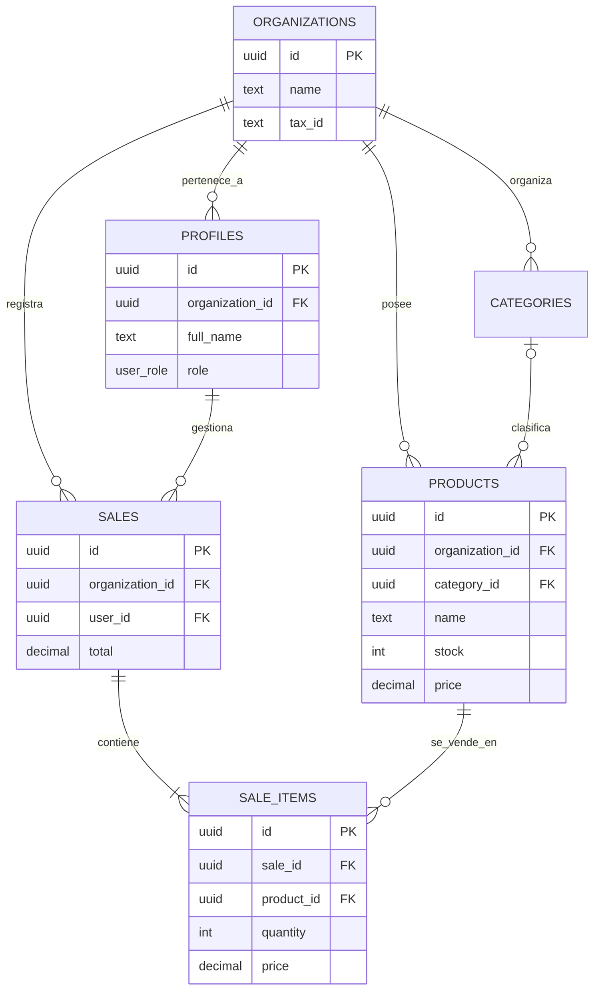

# 🧠 Ingeniería de Backend: GKAD STOCK

Este módulo representa la capa de persistencia y lógica de negocio distribuida del sistema POS. Se ha diseñado siguiendo principios de **Arquitectura Multitenaunt**, **Aislamiento de Datos** e **Integridad Atómica**.

---

## 📊 Diagrama Entidad-Relación (DER)

El siguiente diagrama representa la estructura de la base de datos y cómo las entidades se relacionan para mantener la coherencia del negocio:



---

## 🛡️ Seguridad e Integridad

### 1. Aislamiento Multi-Tenant (RLS)
Ubicado en `security.sql`. Todas las tablas tienen habilitado **Row Level Security (RLS)**. El acceso a los datos se filtra dinámicamente mediante la función `get_my_org()`, la cual extrae el context de la sesión del usuario para garantizar que una tienda NUNCA vea los datos de otra.

### 2. Integridad Referencial
- **Foreign Keys**: Se utilizan llaves foráneas estrictas con `ON DELETE CASCADE` para organizaciones (limpieza de datos) y `ON DELETE RESTRICT` para productos en ventas (auditoría comercial).
- **Constraints**: Restricciones de nivel de fila (CHECK) aseguran que precios y cantidades nunca sean negativos.

### 3. Atomicidad y Concurrencia
- **Triggers**: En `triggers.sql`, el disparador `tr_reduce_stock_pos_sale` garantiza que el inventario se descuente en el momento exacto de la venta.
- **Transacciones**: La **Edge Function** (`functions/process-sale`) utiliza un procedimiento almacenado (RPC) para envolver toda la operación de venta en una transacción **ACID** única. Si el stock es insuficiente para un solo ítem, el sistema revierte (rollback) toda la factura automáticamente.

---

## 🚀 Despliegue de Backend

1. **SQL**: Ejecutar en el SQL Editor de Supabase en este orden:
   - `schema.sql`
   - `security.sql`
   - `triggers.sql`
2. **Edge Functions**:
   ```bash
   supabase functions deploy process-sale --project-ref tu_id_proyecto
   ```
